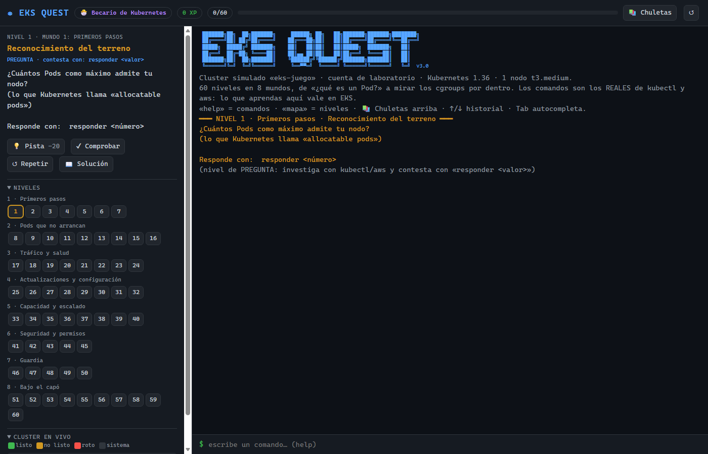

# ⎈ EKS Quest — un juego para aprender Kubernetes

[](https://github.com/RobertoCifre/kubernetes-game/actions/workflows/tests.yml)

**▶ Juega online: https://robertocifre.github.io/kubernetes-game/**

**Aprende `kubectl` y Amazon EKS arreglando un cluster roto, en el navegador y sin instalar nada.**

EKS Quest es un juego gratuito de un solo fichero. Dentro de la página corre un cluster de EKS simulado, y cada nivel lo rompe de una forma distinta: Pods atascados en `Pending`, imágenes que no existen, Services sin endpoints, sondas que fallan, OOMKills, permisos que faltan, nodos que se caen… Se arregla con los **comandos reales** (`kubectl get`, `describe`, `logs`, `exec`, `edit`, `rollout`, `aws eks …`), así que todo lo que practicas te sirve en un cluster de verdad.

Empieza en *«¿cómo se llama este Pod?»* y llega a mirar **por dentro** los contenedores y los nodos: el PID 1, los cgroups, las capabilities de Linux, el token de la ServiceAccount, los init containers, los sidecars, los contenedores de depuración, `crictl`, las reglas de kube-proxy, los ClusterRoles y EKS Pod Identity. Termina con un examen final al estilo de la CKA.



## Cómo jugar

| Opción | Cómo |
|---|---|
| **Online** | Entra en **https://robertocifre.github.io/kubernetes-game/**: no hay que instalar nada. |
| **Solo el fichero** | Descarga [`eks-quest.html`](https://github.com/RobertoCifre/kubernetes-game/releases/latest/download/eks-quest.html) de la última versión y ábrelo con doble clic. Vale cualquier navegador moderno y funciona sin Internet. |
| **Docker** | `docker build -f docker/Dockerfile -t eks-quest:3.4 .` y después `docker run -d -p 8080:8080 --read-only --tmpfs /tmp eks-quest:3.4`; abre http://localhost:8080 |

No necesitas cuenta de AWS, ni cluster, ni `kubectl`, ni `kind`: el cluster es simulado.

**Tu partida** se guarda sola en el navegador (`localStorage`) y no sale de él: la página no hace ninguna petición a Internet. Cada navegador guarda la suya, así que de vez en cuando pulsa **💾 Guardar**: descarga una copia `.json` y te da un código que puedes recuperar con **📂 Cargar** en cualquier navegador u ordenador.

En la terminal del juego, `help` enseña todo lo que entiende, `mapa` los niveles, `pista` da una pista y `solucion` la solución si te atascas.

## Los 76 niveles

| Mundo | Niveles | Qué aprendes |
|---|---|---|
| 1 · Primeros pasos | 1–13 | Leer el cluster: nombres de Deployments, Pods y Services, imágenes, puertos y réplicas; después nodos, namespaces, crear, escalar, etiquetas y logs |
| 2 · Pods que no arrancan | 14–22 | `ErrImagePull`, `CreateContainerConfigError`, `CrashLoopBackOff`, `OOMKilled`, `Pending` |
| 3 · Tráfico y salud | 23–30 | Selectores, `targetPort`, sondas readiness y liveness, port-forward, DNS, LoadBalancers |
| 4 · Actualizaciones y configuración | 31–38 | Despliegues progresivos, volver atrás, ConfigMaps, Secrets, Jobs, CronJobs, DaemonSets |
| 5 · Capacidad y escalado | 39–46 | QoS, HPA, ResourceQuotas, node groups, taints, nodeSelector, drain |
| 6 · Seguridad y permisos | 47–51 | IAM frente a RBAC, Roles, NetworkPolicies, Pod Security |
| 7 · Guardia | 52–56 | Versiones del cluster, PodDisruptionBudgets, nodos caídos, CoreDNS, fallos encadenados |
| 8 · Bajo el capó | 57–66 | PID 1, cgroup v2 (`memory.max`, `cpu.max`), capabilities, token de la ServiceAccount, init containers, `kubectl debug`, ClusterRoles, Pod Identity |
| 9 · Redes y Pods por dentro | 67–75 | IP de cada Pod, endpoints y readiness, DNS del cluster, sidecars que comparten `localhost` y volúmenes, procesos compartidos, `oom_score_adj` según la QoS, `crictl`, cgroups vistos desde el nodo, reglas iptables de kube-proxy |
| 10 · Examen final | 76 | Laboratorio al estilo de la CKA: seis tareas independientes que puntúan por separado (RBAC, vaciar un nodo, NetworkPolicy, Service NodePort, sidecar de logs, kubelet parado). Se aprueba con el 66 % y hay 2 horas, como en el examen |

Cada nivel es una **misión** (arreglas el cluster y se comprueba solo) o una **pregunta** (investigas y contestas con `responder <valor>`). La misión siempre dice qué namespace usar (`-n nivel-N`).

- **Los primeros pasos (Mundo 1) son opcionales:** si ya sabes lo básico, empieza por el Mundo 2 (`nivel 14`). A partir de ahí los niveles se desbloquean en orden.
- **Modo EXPERTO:** el botón de la cabecera (o `experto`) abre todos los niveles.
- **Rangos:** subes de rango según los XP que ganas. Cada pista resta 20 XP y ver la solución deja el nivel a 0.
- **Trampas:** borrar lo que está roto o dar permisos de más no cuenta como arreglarlo.

## Chuletas y solucionario

- [`chuletas/`](chuletas): las chuletas, que también están dentro del juego (botón 📚). Organizadas por secciones (mirar, crear, cambiar, borrar, nodos, diagnosticar…) y con un índice por recurso. Tienen todos los comandos necesarios para resolver los 76 niveles; una prueba lo comprueba.
- [`docs/NIVELES.md`](docs/NIVELES.md): ⚠️ **spoilers**. La preparación, la solución, las pistas y lo que enseña cada nivel.

## Cómo funciona

La página es un pequeño simulador de Kubernetes escrito en JavaScript, sin frameworks ni dependencias:

- almacén de objetos y bucle de reconciliación con controladores para Deployments y ReplicaSets, DaemonSets, Jobs, HPAs y nodos, además del scheduler;
- admisión (ResourceQuota, Pod Security), RBAC, Services, DNS y NetworkPolicies;
- Pods con varios contenedores, una shell tipo busybox dentro de cada uno con `/proc`, `/sys/fs/cgroup` y el token de la ServiceAccount, y herramientas de nodo (`crictl`, `iptables-save`, `nsenter`);
- YAML, JSONPath y JMESPath para `-o yaml`, `-o jsonpath` y `--query`.

Es un simulador, no un cluster real. Entiende los comandos y opciones que necesitan los niveles y los más habituales de alrededor, y algunas salidas de bajo nivel (PIDs, rutas de cgroups, reglas de iptables, `oom_score_adj`) son aproximaciones realistas, no copias exactas. Cuando acabes, practícalo en un cluster de verdad: kind o minikube en tu ordenador, [Killercoda](https://killercoda.com/) en el navegador o un EKS de pruebas.

## Construirlo desde el código

`eks-quest.html` se genera a partir de `src/` y `chuletas/`:

```bash
python construir.py               # Python 3; genera eks-quest.html
node tests/niveles.test.js        # juega los 76 niveles con su solución
node tests/trampas.test.js        # los «arreglos» tramposos o incorrectos NO deben valer
node tests/chuletas.test.js       # las chuletas tienen los comandos de todos los niveles
node tests/simulacro.test.js      # ~12.000 comandos reales de kubectl y aws en todos los niveles: sin errores ni «no soportado»
```

Las cuatro pruebas se ejecutan solas en GitHub en cada cambio (la insignia de arriba).

| Ruta | Contenido |
|---|---|
| `src/sim.js` | El cluster simulado: objetos, controladores, scheduler, contenedores y red |
| `src/comandos.js` | La terminal: los comandos `kubectl` y `aws` |
| `src/vistas.js` | Las tablas de `get`, `describe` y la salida `-o yaml` |
| `src/niveles.js` | Los 76 niveles: preparación, comprobación y pistas |
| `src/ui.js`, `src/plantilla.html`, `src/estilo.css` | La página |
| `src/yaml.js` | YAML, JSONPath y JMESPath |
| `docker/` | Imagen de nginx sin root, Compose y un manifiesto para desplegar el juego en tu propio cluster |

## Licencia

- Código (`src/`, `tests/`, `docker/`, `construir.py`, `eks-quest.html`): [MIT](LICENSE).
- Material didáctico (`chuletas/`, `docs/`): [CC BY 4.0](LICENSE-docs). `eks-quest.html` lleva dentro las chuletas: esa parte sigue siendo CC BY 4.0.
- No incluye código de terceros. La imagen Docker se construye sobre [`nginxinc/nginx-unprivileged`](https://hub.docker.com/r/nginxinc/nginx-unprivileged): si distribuyes la imagen construida, también se aplican las licencias de nginx y de Alpine Linux.

Kubernetes® y CKA (Certified Kubernetes Administrator) son marcas de The Linux Foundation. Amazon EKS y AWS son marcas de Amazon.com, Inc. o sus filiales. Este es un proyecto independiente, sin relación con ellas ni respaldado por ellas. El examen final se inspira en las prácticas públicas de la CKA; no contiene preguntas reales del examen. El cluster del juego es simulado: el número de cuenta (`123456789012`), los IDs de recursos y las salidas de los comandos son ejemplos.

---

**English:** EKS Quest is a free browser game (in Spanish) to learn `kubectl` and Amazon EKS by fixing a simulated cluster: 76 levels from the basics to Pod internals (cgroups, capabilities, sidecars, crictl, kube-proxy) and a timed CKA-style final lab. Play at https://robertocifre.github.io/kubernetes-game/ — code under MIT, learning material under CC BY 4.0.
